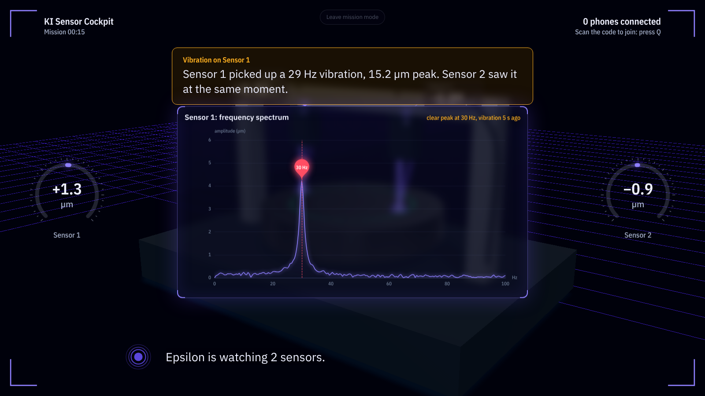

# KI Sensor Cockpit

A voice copilot for Micro-Epsilon sensors. It watches the live data in a 3D
digital twin of the measuring setup, speaks up when something is off, explains
it with charts, writes the incident report, fixes badly set up sensors, and
lets the jury knock the machine from their own phones.




## What it does

| Feature | What the jury sees |
| --- | --- |
| Digital twin | A live 3D model of the measuring setup. The laser beams draw the real triangulation geometry, move with the readings and turn amber or red with the sensor state. Alerts shake the gantry. |
| Voice copilot | Ask in English or German. It answers with measured numbers only, shows charts and speaks up on its own when an alert comes in. |
| Mission mode (**J**) | The lights go out: the same cockpit full screen and dark, glowing lasers, a HUD with dials, and charts that fly in by themselves after each alert. Made for the projector. |
| Judges shake their phone | A judge shakes their phone (or taps Knock). The cockpit knocks the fixture, the real detection finds the vibration on every sensor of that fixture, and the copilot greets the judge by name. |
| Incident report | One click or "write a report": likely causes, next steps, charts around the alert, a setup check and ticket text. Save as PDF, or scan the code to take it on a phone. |
| Setup assistant | Reads a sensor's signal and proposes better settings (averaging, measuring rate) with the physics behind it, previews the result on the real last two seconds of data, applies it after a yes and then measures the improvement. |

Everything runs on dummy data out of the box. To go live you replace data,
not code: sensor names and tolerances in one YAML file, the API key in `.env`,
and either a CSV recording or the MEDAQLib template for live sensors.

---

## Quick start (Windows)

You need Python 3.11 or newer and Node.js 22.12 or newer (the LTS version from nodejs.org).

1. Open PowerShell in the project folder.
2. Run `.\scripts\setup.ps1`. It creates the Python environment, installs everything, builds the cockpit and creates `backend\.env` from the example.
3. Open `backend\.env` and set `COCKPIT_TOKEN` (any password). Add `OPENAI_API_KEY` if you want the AI voice.
4. Run `.\scripts\run.ps1`.
5. Open `http://localhost:8000/?token=<your COCKPIT_TOKEN>` in Chrome or Edge.

If PowerShell says a script "is not digitally signed", Windows still marks the
files as downloaded from the internet. Run `Get-ChildItem -Recurse | Unblock-File`
once in the project folder. If scripts are disabled altogether, run
`Set-ExecutionPolicy -Scope CurrentUser RemoteSigned` once as well.

## Quick start (macOS or Linux)

1. `./scripts/setup.sh`
2. Edit `backend/.env` as above.
3. `./scripts/run.sh`
4. Open `http://localhost:8000/?token=<your COCKPIT_TOKEN>`.

## Developing with hot reload

Run the backend and the Vite dev server side by side:

```powershell
# terminal 1 (on macOS/Linux: .venv/bin/python -m app)
cd backend
.\.venv\Scripts\python.exe -m app

# terminal 2
cd frontend
npm run dev
```

Then open `http://localhost:5173/?token=<your COCKPIT_TOKEN>`. Changes to the
frontend appear instantly; restart the backend after Python changes.

---

## What to replace

| What | Where | Notes |
| --- | --- | --- |
| Team name, copilot name, start language | `backend/config/sensors.yaml` → `cockpit` | `language: de` makes the copilot start in German |
| Sensors: names, models, tolerances | `backend/config/sensors.yaml` → `sensors` | Every line marked `REPLACE` |
| Settings the copilot may change | `sensors.yaml` → `settings` per sensor | Dummy values; replace with the real parameters and ranges |
| Alert thresholds | `sensors.yaml` → `detection` | Tune at the event with real table taps |
| AI voice key and model | `backend/.env` | `gpt-realtime-mini` while building, the full model for the demo |
| Cockpit password | `backend/.env` → `COCKPIT_TOKEN` | Protects voice keys, demo controls and setting changes |
| Real data | `sensors.yaml` → `source` | See the two options below |

### Real data, option A: replay a recording (no code)

1. Record a few minutes with Micro-Epsilon **sensorTOOL** and export CSV.
2. Put the file in `backend/data/`.
3. In `sensors.yaml`, switch the sensor's source:

```yaml
source:
  type: replay
  path: data/my_recording.csv
  column: 1            # column index (0 = first) or the header name
  file_rate_hz: 1000   # sample rate of the recording
  scale: 1000.0        # mm -> µm, if the file is in mm
  offset: 0.0          # reference subtracted after scaling
  decimal: ","         # German number format; "." otherwise
```

German CSVs (`;` and decimal commas) work. Empty cells become invalid
readings. To try it without a sensor: `python scripts/make_sample_recording.py`
in `backend/` creates `data/sample_recording.csv` with a tap and a dropout.

### Real data, option B: live sensor through MEDAQLib

`backend/app/sources/medaqlib.py` is a template. Fill in `_connect()` and
`_read_raw()` from the Python example that ships with MEDAQLib, then set
`type: medaqlib` with `dll_path`, `sensor_type` and `ip_address`. Scaling,
invalid readings and resampling are already handled. If the live source
fails to start, that sensor falls back to the simulator and the cockpit shows
"fallback" in the top bar, so the demo never dies.

`SOURCE_OVERRIDE=simulator` in `.env` forces dummy data for every sensor:
the safe switch if hardware misbehaves on stage.

---

## How it works

```
 Sensors (simulator | CSV replay | MEDAQLib)
        │  500 samples/s per sensor
        ▼
 Backend (Python, FastAPI)
   buffers ─ 10 min full rate + 3 h per-second averages
   analysis ─ noise, FFT peak, drift trend, minutes to tolerance limit
   alert rules ─ vibration, noise, drift, out of range, invalid (with cooldowns)
        │ WebSocket: samples, status, events          │ REST: views + AI tools
        ▼                                              ▼
 Cockpit (React)  ◄──── WebRTC audio + tool calls ────► OpenAI Realtime
   tiles, 3D chart stack, alerts, voice dock
        │
 Phone page (/phone) ◄── WebSocket: events only
```

* **The AI never makes up numbers.** Python computes every value; the voice
  model calls tools (`get_data`, `analyze`, `suggest_settings`, `create_report`)
  and only phrases the answer.
* **Shakes are real detections.** A phone shake knocks the simulated fixture;
  the same rules that watch the real sensors find the vibration.
* **Spoken alerts.** The backend detects an event, the cockpit chimes, and the
  event goes into the voice session as a `[MONITORING ALERT]` message, so the
  copilot speaks first, like Jarvis.
* **The API key never reaches the browser.** The backend mints short-lived
  client secrets.
* **Offline fallback.** Without an API key or internet, typed commands and the
  browser's own speech recognition and voice still run the whole demo script.

Message formats and tool definitions: [docs/CONTRACT.md](docs/CONTRACT.md).

### Project layout

```
backend/
  app/
    main.py          REST API, WebSockets, serves the built cockpit
    engine.py        acquisition loop: sources -> buffers -> rules -> clients
    detection.py     alert rules
    analysis.py      signal maths (pure functions)
    views.py         data behind the four chart views
    tools.py         AI tools that run on the backend
    assistant.py     setup assistant: settings proposal and preview on real data
    report.py        incident reports as JSON and as a printable page
    realtime.py      voice: instructions, tool schemas, client secrets
    sources/         simulator, CSV replay, MEDAQLib template
  config/sensors.yaml   <- your sensors and thresholds
  .env                  <- your keys and switches
  tests/             pytest suite
frontend/
  src/controller.ts  browser-side brain: alerts, voice, commands, tools
  src/lib/voice.ts   OpenAI Realtime over WebRTC with push-to-talk
  src/lib/commands.ts offline commands (English and German)
  src/lib/charts.ts  ECharts views (light and mission themes)
  src/lib/twin.ts    the 3D digital twin (three.js)
  src/components/    twin, readouts, chart stage, copilot, mission HUD, report, setup check
  src/phone/         the judges' phone page: alerts, flashlight, shake detection
docs/                contract, demo script, screenshots
```

---

## Using the cockpit

| Action | How |
| --- | --- |
| Talk | Hold **Space** or the mic button, speak, release |
| Type a command | Copilot box: "show me the last five minutes", "is the sensor broken?", "compare the sensors", "show the drift", "status", "write a report", "check the setup of sensor 1", "go back" |
| Mission mode | **J**, the Mission mode button, or say "mission mode" |
| Latest incident report | **R**, "Write report" on an alert, or say "write a report" |
| Setup check | "Check it" under a sensor, "Check setup" in the conversation, or ask "is sensor 1 set up well?" |
| Previous chart | **←** or say "go back" (the chart flies back into the stack) |
| Dismiss chart | **Delete** or say "dismiss" (the chart turns to dust) |
| Phone QR code | **Q** |
| Demo controls | **D**, then **1** tap, **2** start drift, **3** stop drift, **4** noise burst, **5** dropout, **6** misconfigure sensor 1, **0** reset |
| Sound on/off | **M** |
| Hand gestures | Hand button in the top bar: open palm = back, fist = dismiss, thumbs up = confirm |

Setting changes always need a yes: "set averaging on sensor 1 to 64" → the
copilot asks → "yes". Higher averaging visibly lowers the noise in the
simulator.

### AI voice

Click **Connect AI voice** (needs `OPENAI_API_KEY` and internet). Without it
the cockpit runs in offline mode: browser speech recognition (Chrome/Edge,
needs internet) or typed commands, answered by the browser's voice. Edge on
Windows has the most natural offline voices.

Microphone access only works on `localhost` or HTTPS. Build with
`gpt-realtime-mini`; switch `OPENAI_REALTIME_MODEL` to the full model for the
final demo. A day of testing costs a few dollars.

### Judges' phones

The phones need to reach your laptop over the internet. The simplest way is a
Cloudflare quick tunnel ([download cloudflared](https://developers.cloudflare.com/cloudflare-one/connections/connect-networks/downloads/)):

```bash
cloudflared tunnel --url http://localhost:8000
```

It prints an `https://….trycloudflare.com` address. Press **Q** in the
cockpit, paste the address, and show the QR code on the projector. Judges tap
"Join live alerts"; the top bar counts connected phones. Test with a few
phones on mobile data the evening before. Set a strong `COCKPIT_TOKEN`: the
tunnel makes the cockpit reachable from anywhere.


Phones flash, beep and (on Android) vibrate and blink the flashlight. iPhones
do not let websites vibrate, so the flash and the sound carry the alert there.
Every alert on a phone links to its incident report.

**Shake the machine.** Judges can type their name when they join. "Shake the
machine" asks for motion access (iPhones show a prompt), then three firm
shakes knock the fixture. "Knock instead" does the same with a tap, for
laptops and phones without a motion sensor. Shakes only work while the cockpit
runs on simulated sensors, and each phone can knock once every few seconds.

### Hand gestures (optional)

Gestures run fully in the browser with MediaPipe. For offline use, download
the model once by running `npm run fetch:gestures` in `frontend`. Without it the
cockpit loads the model from the internet when you switch gestures on.

---

## Tests

```powershell
# 31 tests: analysis, alert rules, replay, API, WebSockets, assistant, reports, shakes (on macOS/Linux: .venv/bin/python -m pytest)
cd backend
.\.venv\Scripts\python.exe -m pytest

# in frontend
npm run typecheck
```

## Troubleshooting

| Problem | Fix |
| --- | --- |
| Page says "Frontend not built" | In `frontend`, run `npm install`, then `npm run build` |
| `EBADENGINE` warnings, then `ERR_UNKNOWN_FILE_EXTENSION` for `typescript\bin\tsc` | Node.js is too old. Install the LTS version from nodejs.org, open a new terminal and run the setup again |
| Demo buttons or voice say "locked" | Open the cockpit with `?token=<COCKPIT_TOKEN>` or click the lock icon |
| "Voice is off: set OPENAI_API_KEY" | Add the key to `backend/.env` and restart the backend |
| Voice connects but never answers | Check the model name in `.env`; look at the browser console for the error |
| No microphone prompt | Use `http://localhost:…` or HTTPS, not the laptop's IP address |
| Top bar says "fallback" | The live source failed; the reason is in the sensor tile tooltip and the backend log |
| Too many or too few alerts | Tune `detection` in `sensors.yaml` (ratios and cooldowns) |
| Port 8000 busy | Change `PORT` in `.env` |
