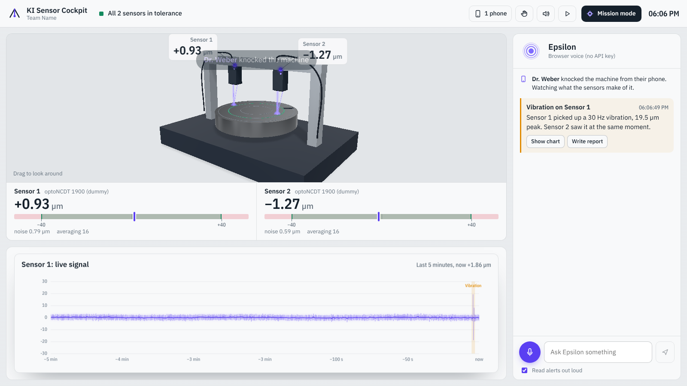
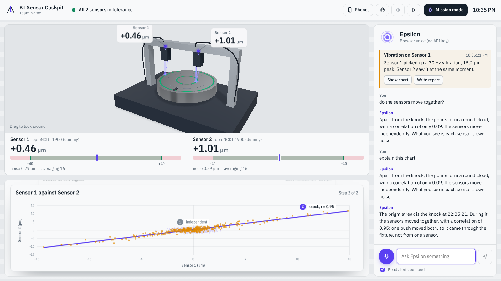
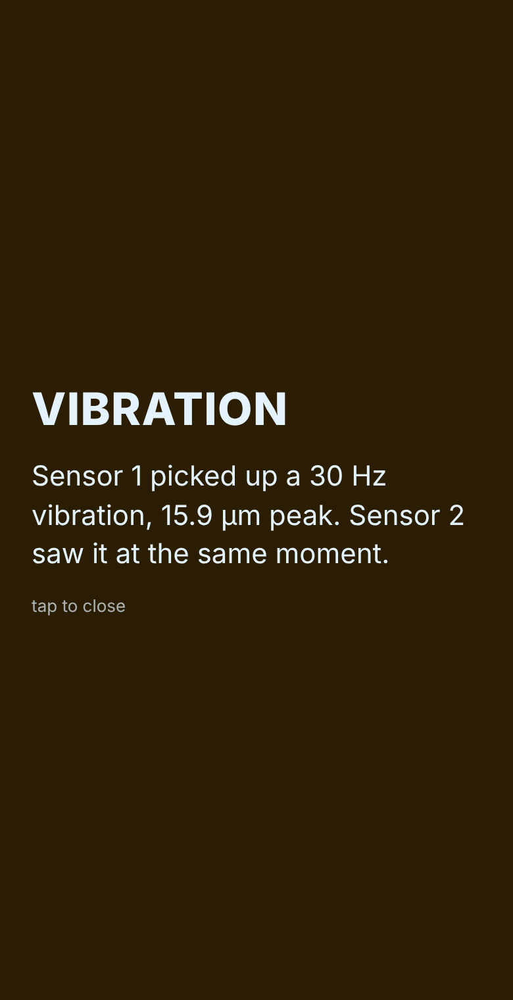

# KI Sensor Cockpit

A voice copilot for Micro-Epsilon sensors. It watches the live data in a 3D
digital twin of the measuring setup, speaks up when something is off, picks
the chart that answers your question and walks you through it, zooms from the
whole shift down to single readings, writes the incident report, fixes badly
set up sensors, and lets the jury knock the machine from their own phones.






## What it does

| Feature | What the jury sees |
| --- | --- |
| Digital twin | A live 3D model of the measuring setup. The laser beams draw the real triangulation geometry, move with the readings and turn amber or red with the sensor state. Alerts shake the gantry. |
| Voice copilot | Ask in English or German. It answers with measured numbers only, shows charts and speaks up on its own when an alert comes in. |
| Charts the AI picks | Ask a question and the copilot builds the chart that answers it: "how are the readings spread?" gives a histogram with Cp and Cpk, "which hour was calmest?" a box plot per hour, "do the sensors move together?" a scatter plot, "compare the noise" a bar chart. |
| Charts that point while it talks | Say "explain this chart". The copilot walks through it step by step, and the part it is talking about lights up with a numbered marker at the moment it says it. |
| The whole shift, down to single readings | "Show me the whole shift": eight hours on one timeline, with every alert marked. Scroll to zoom in, or let the tour fly to each incident, down to every single reading of a knock. |
| The laser paints the part | In the twin, the part turns under the sensors and each laser paints its track: green in tolerance, amber close to the limit, red outside it. A dent on the part shows up as a red patch that comes round on every turn. |
| Mission mode (**J**) | The lights go out: the same cockpit full screen and dark, glowing lasers, a HUD with dials, and charts that fly in by themselves after each alert. Made for the projector. |
| Judges shake their phone | A judge shakes their phone (or taps Knock). The cockpit knocks the fixture, the real detection finds the vibration on every sensor of that fixture, and the copilot greets the judge by name. |
| Incident report | One click or "write a report": likely causes, next steps, charts around the alert, a setup check and ticket text. Save as PDF, or scan the code to take it on a phone. |
| Load a recording | **Load file** in the top bar takes a CSV export from the measuring software. The whole file is checked with the same rules as the live sensors, with no code. The sheet says how it read the file and asks only for what it could not know. |
| Anomaly chain | Pick an incident in the list. The chart highlights it, the twin marks where on the part it was measured, Epsilon explains why it was flagged, the checks to carry out are listed, and the report and CSV are one click away. |
| Ask the manuals | "What is the linearity of the ILD5500-50?" The copilot searches the sensor manuals (PDF) and answers only from them, with the exact value, its conditions from the footnotes, and the section and page it came from. The passages are on screen, each with a link that opens the PDF at that page. If the manual does not say it, the copilot says so instead of guessing. |
| Setup assistant | Reads a sensor's signal and proposes better settings (averaging, measuring rate) with the physics behind it, previews the result on the real last two seconds of data, applies it after a yes and then measures the improvement. |

Everything runs on dummy data out of the box. To go live you replace data,
not code: sensor names and tolerances in one YAML file, the API key in `.env`,
and a CSV export loaded in the top bar (or the MEDAQLib template for live sensors).

The eight hours of earlier incidents on the shift timeline are made up by the
simulator so the demo has a past. With a recording or a live sensor nothing is
made up: the timeline starts when the cockpit starts.

**For the team:** [docs/TEAM_WALKTHROUGH.md](docs/TEAM_WALKTHROUGH.md) takes
every member through the anomaly chain step by step, then through the rest of
the cockpit, and lists what to check with the real files on Friday.

---

## Quick start (Windows)

You need Python 3.11 or newer and Node.js 22.12 or newer (the LTS version from nodejs.org).

1. Open PowerShell in the project folder.
2. Run `.\scripts\setup.ps1`. It creates the Python environment, installs everything, builds the cockpit and creates `backend\.env` from the example.
3. Open `backend\.env` and set `COCKPIT_TOKEN` (any password). Add `OPENAI_API_KEY` if you want the AI voice.
4. Run `.\scripts\run.ps1`.
5. Open `http://localhost:8000/?token=<your COCKPIT_TOKEN>` in Chrome or Edge.

If PowerShell says a script "is not digitally signed", Windows still marks the
files as downloaded from the internet. Run `Get-ChildItem -Recurse | Unblock-File`
once in the project folder. If scripts are disabled altogether, run
`Set-ExecutionPolicy -Scope CurrentUser RemoteSigned` once as well.

## Quick start (macOS or Linux)

1. `./scripts/setup.sh`
2. Edit `backend/.env` as above.
3. `./scripts/run.sh`
4. Open `http://localhost:8000/?token=<your COCKPIT_TOKEN>`.

## Developing with hot reload

Run the backend and the Vite dev server side by side:

```powershell
# terminal 1 (on macOS/Linux: .venv/bin/python -m app)
cd backend
.\.venv\Scripts\python.exe -m app

# terminal 2
cd frontend
npm run dev
```

Then open `http://localhost:5173/?token=<your COCKPIT_TOKEN>`. Changes to the
frontend appear instantly; restart the backend after Python changes.

---

## What to replace

| What | Where | Notes |
| --- | --- | --- |
| Team name, copilot name, start language | `backend/config/sensors.yaml` → `cockpit` | `language: de` makes the copilot start in German |
| Sensors: names, models, tolerances | `backend/config/sensors.yaml` → `sensors` | Every line marked `REPLACE` |
| How fast the measured part turns | `sensors.yaml` → `engine.part_rpm` | Sets where the twin paints each reading on the part; `0` if the part does not turn |
| Settings the copilot may change | `sensors.yaml` → `settings` per sensor | Dummy values; replace with the real parameters and ranges |
| Alert thresholds | `sensors.yaml` → `detection` | Tune at the event with real table taps |
| AI voice key and model | `backend/.env` | `gpt-realtime-mini` while building, the full model for the demo |
| Cockpit password | `backend/.env` → `COCKPIT_TOKEN` | Protects voice keys, demo controls and setting changes |
| Real data | **Load file** in the top bar, or `sensors.yaml` → `source` | See the options below |
| Sensor manuals | PDF files in `backend/knowledge/` | Read on start-up; see [Manual search](#manual-search-rag) |

### Real data, the quick way: analyse a whole file (no code)

1. Record a few minutes with Micro-Epsilon **sensorTOOL** and export CSV.
2. Put the file in `backend/data/`. The cockpit reads its own copy, so the original stays unchanged.
3. Click **Load file** in the top bar, choose the file, and read "2. Check how the file was read".
4. Type the part speed in rpm (0 if unknown), and the sample rate if the file has no time column.
5. Type the tolerance limits in µm for each sensor, and untick the columns that are not sensors.
6. Click **Analyse the recording**, then **Show the incidents**.

The same steps run from the command line, with one PASS or FAIL per step:
`backend/.venv/bin/python scripts/chain_check.py data/my_file.csv --rpm 8.6`
(add `--rate 1000` for a file without a time column).

### Real data, option A: replay a file as a live sensor (YAML)

1. Record a few minutes with Micro-Epsilon **sensorTOOL** and export CSV.
2. Put the file in `backend/data/`.
3. In `sensors.yaml`, switch the sensor's source:

```yaml
source:
  type: replay
  path: data/my_recording.csv
  column: 1            # column index (0 = first) or the header name
  file_rate_hz: 1000   # sample rate of the recording
  scale: 1000.0        # mm -> µm, if the file is in mm
  offset: 0.0          # reference subtracted after scaling
  decimal: ","         # German number format; "." otherwise
```

German CSVs (`;` and decimal commas) work. Empty cells become invalid
readings. To try it without a sensor: `python scripts/make_sample_recording.py`
in `backend/` creates `data/sample_recording.csv` with a tap and a dropout.

### Real data, option B: live sensor through MEDAQLib

`backend/app/sources/medaqlib.py` is a template. Fill in `_connect()` and
`_read_raw()` from the Python example that ships with MEDAQLib, then set
`type: medaqlib` with `dll_path`, `sensor_type` and `ip_address`. Scaling,
invalid readings and resampling are already handled. If the live source
fails to start, that sensor falls back to the simulator and the cockpit shows
"fallback" in the top bar, so the demo never dies.

`SOURCE_OVERRIDE=simulator` in `.env` forces dummy data for every sensor:
the safe switch if hardware misbehaves on stage.

---

## How it works

```
 Sensors (simulator | CSV replay | MEDAQLib)
        │  500 samples/s per sensor
        ▼
 Backend (Python, FastAPI)
   buffers ─ 10 min full rate, 8 h per-second min/mean/max,
             full-rate snapshots around every alert
   analysis ─ noise, FFT peak, drift trend, minutes to tolerance limit
   alert rules ─ vibration, noise, drift, out of range, invalid (with cooldowns)
   incidents ─ a whole file, same rules: evidence, checks, explanation, spot on the part, report
   charts ─ histogram, box plot, scatter, bar, shift timeline,
            each with the steps that explain it
        │ WebSocket: samples, status, events          │ REST: views + AI tools
        ▼                                              ▼
 Cockpit (React)  ◄──── WebRTC audio + tool calls ────► OpenAI Realtime
   3D twin, chart stage, copilot, mission HUD
        │
 Phone page (/phone) ◄── WebSocket: events only
```

* **The AI never makes up numbers.** Python computes every value; the voice
  model calls tools (`get_data`, `analyze`, `make_chart`, `explain_chart`,
  `show_shift`, `suggest_settings`, `create_report`, `list_incidents`,
  `investigate_incident`) and only phrases the answer.
* **An incident is a chain, not a picture.** Each incident keeps the window of
  data around it, the rules that fired, the checks and their results, the
  explanation in order, the checks to carry out (with the playbook in
  `backend/config/playbook.yaml`), what the file does not tell, and the place on
  the part, when the part speed is known. The chart, the twin, the copilot and
  the report all read the same record.
* **Explanations are computed, not guessed.** Every chart comes with its
  explanation steps, each tied to a place on the chart (a line, a band, a
  point, a time range). The copilot says the steps, and the cockpit reveals
  each marker as its sentence starts.
* **Zooming never loses a spike.** Each slice of the timeline keeps its lowest
  and highest reading as a band around the average, so a knock of a few
  milliseconds is still visible in the eight-hour view.
* **Shakes are real detections.** A phone shake knocks the simulated fixture;
  the same rules that watch the real sensors find the vibration.
* **Spoken alerts.** The backend detects an event, the cockpit chimes, and the
  event goes into the voice session as a `[MONITORING ALERT]` message, so the
  copilot speaks first, like Jarvis.
* **The API key never reaches the browser.** The backend mints short-lived
  client secrets.
* **Offline fallback.** Without an API key or internet, typed commands and the
  browser's own speech recognition and voice still run the whole demo script.

Message formats and tool definitions: [docs/CONTRACT.md](docs/CONTRACT.md).

### Project layout

```
backend/
  app/
    main.py          REST API, WebSockets, serves the built cockpit
    engine.py        acquisition loop: sources -> buffers -> rules -> clients
    detection.py     alert rules
    analysis.py      signal maths (pure functions)
    views.py         data behind the live chart views
    explore.py       charts the copilot picks: histogram, box plot, scatter, bar
    insights.py      the steps that explain each chart, tied to places on it
    timeline.py      the shift timeline: picks the finest data for each zoom level
    tools.py         AI tools that run on the backend
    knowledge.py     manual search (RAG): PDF chunks with section and page, BM25 + optional embeddings
    assistant.py     setup assistant: settings proposal and preview on real data
    report.py        incident reports as JSON and as a printable page
    realtime.py      voice: instructions, tool schemas, client secrets
    ingest.py        reads a file: delimiter, decimals, time column, units, counter columns
    recording_service.py, recording_api.py   loading, analysing and the incident routes
    incidents.py     finds the incidents of a whole recording, with evidence and snapshot
    investigate.py   checks, explanation, checks to carry out and location of one incident
    incident_report.py, incident_tools.py    the incident report page and the copilot's incident tools
    sources/         simulator, CSV replay, recording playback, MEDAQLib template
  config/sensors.yaml   <- your sensors and thresholds
  config/playbook.yaml  <- the checks to carry out, by kind of alert
  knowledge/            <- the sensor manuals (PDF, Markdown or text) the copilot may quote
  scripts/ask_manual.py        ask the manuals from the command line
  scripts/chain_check.py       the anomaly chain, one PASS or FAIL per step
  scripts/make_demo_recording.py   simulated exports in messy formats, for tests
  .env                  <- your keys and switches
  tests/             pytest suite
frontend/
  src/controller.ts  browser-side brain: alerts, voice, commands, tools
  src/lib/voice.ts   OpenAI Realtime over WebRTC with push-to-talk
  src/lib/commands.ts offline commands (English and German)
  src/lib/charts.ts  ECharts views (light and mission themes) and the explanation markers
  src/lib/twin.ts    the 3D digital twin (three.js), including the painted part
  src/lib/incidents.ts the chart and the spot on the part for one incident
  src/components/    twin, readouts, chart stage, shift timeline, copilot, mission HUD, report, setup check
  src/components/RecordingSheet.tsx   Load file: read, check, limits, analyse
  src/components/IncidentDock.tsx     the incident list and the incident panel
  src/components/ManualPanel.tsx      the manual panel: question, answer, passages with page links
  src/phone/         the judges' phone page: alerts, flashlight, shake detection
docs/                contract, demo script, team walkthrough, screenshots
```

---

## Using the cockpit

| Action | How |
| --- | --- |
| Talk | Hold **Space** or the mic button, speak, release |
| Type a command | Copilot box: "show me the last five minutes", "is the sensor broken?", "compare the sensors", "show the drift", "status", "write a report", "check the setup of sensor 1", "go back" |
| Ask for a chart | "how are the readings spread?", "which hour was calmest?", "show the spread per sensor", "do the sensors move together?", "compare the noise" |
| Explain a chart | "explain this chart" or "walk me through it" |
| Load a recording | **Load file** in the top bar: choose the file, read it, set the part speed and limits, analyse |
| Incidents | **I**, the Incidents button, or type "incidents" |
| One incident | Click it in the list, or type "incident 2" |
| Explain an incident | **Explain** in the incident panel, or type "explain incident 2" |
| Back to the simulator | **Load file**, then **Back to the simulator** |
| Whole shift | "show me the whole shift" or "what happened today?". Scroll or pinch to zoom, drag to pan, click an alert line to fly to it |
| Mission mode | **J**, the Mission mode button, or say "mission mode" |
| Latest incident report | **R**, "Write report" on an alert, or say "write a report" |
| Setup check | "Check it" under a sensor, "Check setup" in the conversation, or ask "is sensor 1 set up well?" |
| Previous chart | **←** or say "go back" (the chart flies back into the stack) |
| Dismiss chart | **Delete** or say "dismiss" (the chart turns to dust) |
| Ask the manuals | **K** or the Manuals button, or ask the copilot ("what supply voltage does it need?", "pin assignment of the M16 plug") |
| Phone QR code | **Q** |
| Demo controls | **D**, then **1** tap, **2** start drift, **3** stop drift, **4** noise burst, **5** dropout, **6** misconfigure sensor 1, **7** dent in the part, **0** reset |
| Sound on/off | **M** |
| Hand gestures | Hand button in the top bar: open palm = back, fist = dismiss, thumbs up = confirm |

Setting changes always need a yes: "set averaging on sensor 1 to 64" → the
copilot asks → "yes". Higher averaging visibly lowers the noise in the
simulator.

### Manual search (RAG)

The copilot answers questions about the sensors from their manuals, never from
memory. `backend/knowledge/` ships with the optoNCDT 5500 operating
instructions; add the manuals of your own sensors as PDF, Markdown or text files
and they are read the next time anyone asks (or call `POST /api/knowledge/reload`).

How it works:

1. **Reading.** Each PDF is read with its layout kept, so table columns stay
   apart (shown as ` | `). Running headers and footers are removed, the number
   printed in the footer becomes the page number, and the table of contents gives
   the section numbers and titles. The table of contents and the cover are not indexed.
2. **Chunks with citations.** A passage never crosses a section or a page, so
   every passage cites exactly: "Section 3.4 Technical data, measuring range,
   Tab. 3.1, Page 12". Footnotes a passage refers to (`[6]`) are attached to it,
   because on datasheets the test conditions live there.
3. **Search.** BM25 keyword search, offline and with no extra service. Model
   numbers like `ILD5500-50` are kept whole. With `OPENAI_API_KEY` set, every passage
   is also embedded once (`OPENAI_EMBEDDING_MODEL`, cached in `knowledge/.cache/`)
   and both rankings are fused, so "how hot can it get" still finds the temperature range.
4. **Answer.** The voice copilot calls `search_manual`, gets the best passages
   with the rule to answer only from them, and says the value with its section
   and page while the passages appear in the Manuals panel. Typed questions
   without the AI voice go to `POST /api/knowledge/ask`. With a key,
   `OPENAI_ANSWER_MODEL` writes the answer from the passages. Without one, the
   matching lines are quoted directly. Either way the answer is "not mentioned"
   when nothing in the manuals matches.

From the command line, without starting the cockpit:

```bash
cd backend
.venv/bin/python scripts/ask_manual.py "What is the linearity of the ILD5500-50?"
.venv/bin/python scripts/ask_manual.py --search "pin assignment" -k 5
.venv/bin/python scripts/ask_manual.py --list --rebuild
```

Scanned PDFs without a text layer cannot be read; run OCR on them first.

### AI voice

Click **Connect AI voice** (needs `OPENAI_API_KEY` and internet). Without it
the cockpit runs in offline mode: browser speech recognition (Chrome/Edge,
needs internet) or typed commands, answered by the browser's voice. Edge on
Windows has the most natural offline voices.

Microphone access only works on `localhost` or HTTPS. Build with
`gpt-realtime-mini`; switch `OPENAI_REALTIME_MODEL` to the full model for the
final demo. A day of testing costs a few dollars.

### Judges' phones

The phones need to reach your laptop over the internet. The simplest way is a
Cloudflare quick tunnel ([download cloudflared](https://developers.cloudflare.com/cloudflare-one/connections/connect-networks/downloads/)):

```bash
cloudflared tunnel --url http://localhost:8000
```

It prints an `https://….trycloudflare.com` address. Press **Q** in the
cockpit, paste the address, and show the QR code on the projector. Judges tap
"Join live alerts"; the top bar counts connected phones. Test with a few
phones on mobile data the evening before. Set a strong `COCKPIT_TOKEN`: the
tunnel makes the cockpit reachable from anywhere.



Phones flash, beep and (on Android) vibrate and blink the flashlight. iPhones
do not let websites vibrate, so the flash and the sound carry the alert there.
Every alert on a phone links to its incident report.

**Shake the machine.** Judges can type their name when they join. "Shake the
machine" asks for motion access (iPhones show a prompt), then three firm
shakes knock the fixture. "Knock instead" does the same with a tap, for
laptops and phones without a motion sensor. Shakes only work while the cockpit
runs on simulated sensors, and each phone can knock once every few seconds.

### Hand gestures (optional)

Gestures run fully in the browser with MediaPipe. For offline use, download
the model once by running `npm run fetch:gestures` in `frontend`. Without it the
cockpit loads the model from the internet when you switch gestures on.

---

## Tests

```powershell
# 104 tests: analysis, alert rules, replay, API, WebSockets, assistant, reports, shakes, charts, shift timeline, file reading, incidents, copilot tools, manual search (on macOS/Linux: .venv/bin/python -m pytest)
cd backend
.\.venv\Scripts\python.exe -m pytest

# the anomaly chain on a running cockpit: one PASS or FAIL per step
.\.venv\Scripts\python.exe scripts\chain_check.py

# in frontend
npm run typecheck
```

## Troubleshooting

| Problem | Fix |
| --- | --- |
| Page says "Frontend not built" | In `frontend`, run `npm install`, then `npm run build` |
| `EBADENGINE` warnings, then `ERR_UNKNOWN_FILE_EXTENSION` for `typescript\bin\tsc` | Node.js is too old. Install the LTS version from nodejs.org, open a new terminal and run the setup again |
| Demo buttons or voice say "locked" | Open the cockpit with `?token=<COCKPIT_TOKEN>` or click the lock icon |
| "Voice is off: set OPENAI_API_KEY" | Add the key to `backend/.env` and restart the backend |
| Voice connects but never answers | Check the model name in `.env`; look at the browser console for the error |
| No microphone prompt | Use `http://localhost:…` or HTTPS, not the laptop's IP address |
| Top bar says "fallback" | The live source failed; the reason is in the sensor tile tooltip and the backend log |
| The sheet asks for a sample rate | The file has no time column. Type its rate in Hz |
| The twin shows no spot on the part | Type the part speed in the Load a recording sheet. 0 means unknown |
| "No incident was found" after analysing | Check the limits and the part speed in the sheet, then analyse again |
| Too many or too few alerts | Tune `detection` in `sensors.yaml` (ratios and cooldowns) |
| Port 8000 busy | Change `PORT` in `.env` |
| Manuals panel says "No manuals loaded" | Put PDF files in `backend/knowledge/`; check `scripts/ask_manual.py --list` for files that could not be read |
| A manual answer cites the wrong page | Run `scripts/ask_manual.py --rebuild` after replacing a PDF with a file of the same name and size |
